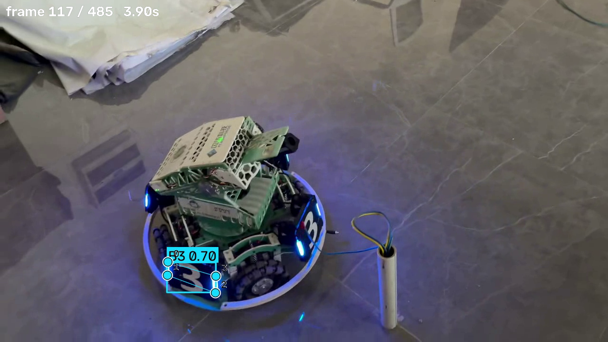

# YOLO26n 装甲板视频推理

用 Ultralytics YOLO26n-pose 模型做装甲板检测和关键点推理。输入一段视频，逐帧推理，画出检测框、类别、置信度和 4 个关键点，最后保存成能播放的结果视频。

## 1. 项目完成的功能

- 加载 best.pt 权重，用 cv2 逐帧读取视频
- 每帧送入 model.predict() 做推理
- 检出目标时画检测框、类别、置信度，以及模型预测的 4 个关键点
- 保存结果视频，用 cv2.VideoWriter 写出，编码器依次尝试 mp4v、avc1、XVID、MJPG

关于关键点：取自模型 pose 分支的预测结果 results.keypoints.xy，形状是 [N, 4, 2]。N 是这帧检出的目标数，4 是每个目标 4 个点，2 是每个点的 x、y 坐标。没有用检测框的四个角代替。

这次运行的数字可以验证：检出目标 715 个，关键点 2860 个，715 × 4 = 2860，每个目标都输出了完整的 4 个点。

绘制的内容：

- 检测框：颜色按类别生成，同类别颜色固定
- 类别和置信度：例如 B3 0.70，带同色底块
- 4 个关键点：白圈加彩色内点加黑色描边，旁边标序号 0 1 2 3，加 --link-kpts 会连线成四边形

如果某个点是 (0, 0)，或者明显偏离对应的检测框，就当无效预测跳过不画。

## 2. 运行环境

- Python 3.13.15
- 操作系统 Windows 11
- 推理设备：CPU

没用 GPU。作业不要求实时推理，从 PyPI 装的 torch 默认就是 CPU 版，不用配 CUDA 环境。如果要跑 GPU，先按 pytorch.org 装对应 CUDA 版本的 torch，然后加 --device 0。

主要依赖（实测版本）：

- ultralytics 8.4.176
- torch 2.14.1
- torchvision 0.29.1
- opencv-python 5.0.0.93
- numpy 2.5.4
- pillow 12.3.0
- pyyaml 6.0.3

完整清单在 requirements.txt。

## 3. 模型权重的准备和放置

best.pt 是课程参考材料里给的，这次作业不重新训练，直接拿去推理。

从模型文件里读出来的信息：

- task 是 pose，是姿态估计模型，不是普通检测
- kpt_shape 是 [4, 2]，每个目标 4 个关键点，各含 x、y
- nc 是 6，共 6 个类别
- names 是 B1 B2 B3 R1 R2 R3，蓝方和红方各 3 类装甲板

权重文件不用提交到 Git，已经在 .gitignore 里用 *.pt 排除了。脚本默认从下面这个位置读：

```
D:\桌面\best.pt
```

放在别的地方就用 --weights 指定，不用改代码：

```bash
python infer.py --weights D:\weights\best.pt --video D:\videos\rm.mp4
```

也可以直接改 infer.py 顶部的 DEFAULT_WEIGHTS。

## 4. 安装步骤和运行命令

### 4.1 安装依赖

```bash
cd /d D:\yolo-armor-inference
python -m venv .venv
.venv\Scripts\activate
pip install -r requirements.txt -i https://pypi.tuna.tsinghua.edu.cn/simple
```

激活成功后命令行前面会出现 (.venv)。

如果 pip 不加镜像源，torch 会下得很慢，建议保留 -i 参数。

### 4.2 运行命令

```bash
python infer.py --video "D:\桌面\RM视频.mp4"
```

其他用法：

```bash
python infer.py --video "D:\桌面\RM视频.mp4" --kpt-radius 8 --link-kpts
python infer.py --weights D:\桌面\best.pt --video "D:\桌面\RM视频.mp4" --conf 0.4 --out D:\result.mp4
python infer.py --video "D:\桌面\RM视频.mp4" --device cpu
```

### 4.3 参数说明

- --weights：权重路径，默认 D:\桌面\best.pt
- --video：视频路径，必填
- --out：输出路径，默认 runs/infer/video_result.mp4
- --conf：置信度阈值，默认 0.25
- --iou：NMS 的 IoU 阈值，默认 0.45
- --imgsz：推理分辨率，默认 640
- --device：cpu 或 0，不填自动选
- --show：实时显示画面，按 q 退出，默认关闭
- --kpt-radius：关键点圆点半径，默认 5
- --link-kpts：把 4 个关键点连起来，默认关闭
- --link-order：连线顺序，默认 0-1-2-3-0，填 none 不连
- --box-thickness：检测框线宽，不填按分辨率自动算
- --no-labels：不画类别和置信度标签

权重路径、视频路径、输出位置都能用命令行参数改，不用动代码。

### 4.4 结果保存位置

```
D:\yolo-armor-inference\runs\infer\video_result.mp4
```

输出的视频保持原视频的分辨率和帧率，画面跟源视频逐帧对应。编码器按 mp4v、avc1、XVID、MJPG 的顺序试，用第一个能用的。如果目标路径写不进去，会自动换扩展名。runs/ 已经在 .gitignore 里排除，结果视频不提交。

## 5. 视频拍摄信息

- 文件：RM视频.mp4
- 拍摄地点：水建 D402，室内，灯光照明
- 拍摄设备：手机
- 分辨率：1280 × 720
- 帧率：30 fps
- 总帧数：486 帧
- 时长：约 16.2 秒
- 场景：画面里是一台步兵机器人，处于运动状态。只有蓝色方装甲板，对应模型的 B1、B2、B3 类别，没有红色方装甲板

## 6. 代表性结果截图

截的是结果视频第 117 帧，3.90 秒。这一帧检测框、类别置信度标签 B3 0.70，以及 4 个关键点（编号 0 1 2 3，有连线）都看得清。



## 7. 实际识别表现和问题记录

### 7.1 整体统计

- 处理帧数：486
- 含检出的帧数：484，占 99.6%
- 检出目标总数：715
- 有效关键点总数：2860
- 平均每帧检出：约 1.5 个
- 输出视频大小：11.73 MB

### 7.2 识别表现

召回情况：486 帧里 484 帧有检出，只有 2 帧没有，基本全程跟踪上了。

关键点完整：715 个目标一共输出 2860 个关键点，正好是 715 × 4，没有缺。

类别区分：模型能区分蓝方和红方，也能区分不同编号的装甲板。

跨阵营误检：视频里只有蓝方装甲板，检测结果也只出现 B1、B2、B3，没有把蓝方误判成红方。单一阵营的场景下没有凭空出现另一阵营，这一类误检可以排除。

### 7.3 遇到的问题和处理方法

**问题 1：模型输出的是 [4, 2] 不是 [4, 3]，没法按关键点置信度过滤**

一般姿态模型（比如人体关键点）输出 [K, 3]，第三个值是可见性置信度。这个模型 kpt_shape 是 [4, 2]，只有坐标没有置信度。

处理办法是改用坐标合理性判断：坐标为 (0, 0)，或者明显偏离对应检测框（超出框宽或框高 35%）的点，判定为无效预测跳过不画，免得画出飞到画面外的点。

**问题 2：中文路径导致控制台报错**

视频路径里有中文（D:\桌面\RM视频.mp4），Windows 控制台默认是 GBK 编码，print 中文路径会抛 UnicodeEncodeError，整个推理中断。

处理办法是在脚本开头把标准输出改成 UTF-8：

```python
sys.stdout.reconfigure(encoding="utf-8", errors="replace")
```

**问题 3：视频编码器兼容性**

cv2.VideoWriter 用固定编码器时，有时候创建失败，或者生成的视频打不开。

处理办法是让编码器自动降级，依次试 mp4v、avc1、XVID、MJPG，同时自动调整输出扩展名，保证能生成可播放的视频。

**问题 4：Python 3.13 的兼容性**

有些教程建议用 Python 3.8 到 3.11，担心 3.13 没有预编译包。

先确认了 torch（2.6.0 起支持 3.13）和 ultralytics 都有适配的 wheel，实测在 3.13.15 上装和跑都正常，不用降级。

### 7.4 漏检和误检的记录

逐帧看结果视频后，实际观察到下面几种情况，没有做美化。

**现象一：遮挡加弱光导致漏检**

机器人侧倾的时候有漏检。典型的一帧在 3 秒附近，这帧只检出 1 个目标，标的是 B3 0.68，画面右边还有一块蓝方装甲板没检出。

原因有两个：

- 遮挡：机器人侧倾时，装甲板被车体结构挡住一部分
- 光照不足：没检出的那块装甲板朝向镜头的是内侧和底部，在阴影里，蓝色灯条和周围的对比度掉下来了

两个原因叠一起，置信度落到阈值 0.25 以下。同一帧里唯一检出的那个目标置信度也只有 0.68，说明这段画面整体成像条件偏难。

**现象二：关键点位置准确**

检出成功的帧里，4 个关键点连成的四边形跟装甲板轮廓基本吻合，机器人转动时关键点跟着转，没看到偏离装甲板的情况。

**现象三：没有跨阵营误检**

画面里只有蓝方装甲板，检测结果里也只出现 B1、B2、B3，没有出现红色方 R 类，可以排除把蓝方误判成红方这类类别错误。

**现象四：没有对非装甲板物体的误检**

地板、车体结构、线缆这些都没被误框成目标。这条是抽样查看得出的结论。

**小结**

这个视频主要的问题是被遮挡和弱光时的漏检，不是误检或者类别错误。光照充足、装甲板完整可见的帧里，检测和关键点都正常。

如果想让这类场景表现好一些，可以降低 --conf 阈值（代价是可能引入误检）、提高 --imgsz，或者在训练数据里补一些遮挡和弱光的样本。

### 7.5 如果全片都没有检出，怎么排查

这次运行有检出，没遇到这个情况。换别的视频如果出现全片零检出，按这个顺序查：

1. 检查权重：用 --weights 指的文件存不存在、是不是 pose 模型。脚本启动时会打印任务类型和关键点形状，如果显示 task='detect' 就是权重传错了
2. 检查视频输入：路径对不对、能不能被 cv2.VideoCapture 打开。脚本第 2 步会打印分辨率和帧率，如果是 0x0 说明读取失败
3. 调推理参数：把 --conf 降到 0.1 试试，看是不是阈值太高；提高 --imgsz 改善小目标；确认 --device 设置合理
4. 检查视频内容：看视频里是不是真的有模型认识的装甲板。拿风景或者录屏去测必然零检出，这是正常的，不是故障

## 目录结构

```
yolo-armor-inference/
├── infer.py
├── requirements.txt
├── README.md
├── .gitignore
├── snapshot.py
└── docs/
    ├── model_info.md
    └── images/
        └── result.png
```

截图用的 snapshot.py 是个辅助工具，用来从结果视频里挑帧，导出无损 PNG。用法：

```bash
python snapshot.py --video runs\infer\video_result.mp4
```

运行前需要准备、但没有提交的文件：

- 模型权重：被 *.pt、weights/、models/ 排除。由课程材料提供，放到 D:\桌面\best.pt，或者用 --weights 指定
- 原始视频：被 *.mp4 等视频格式排除。自己拍的，用 --video 指定
- 结果视频：被 runs/ 排除。跑脚本自动生成在 runs/infer/
- 虚拟环境：被 .venv/ 排除。按 4.1 节创建

## 备注

用的开源项目是 Ultralytics YOLO，AGPL-3.0 许可。
